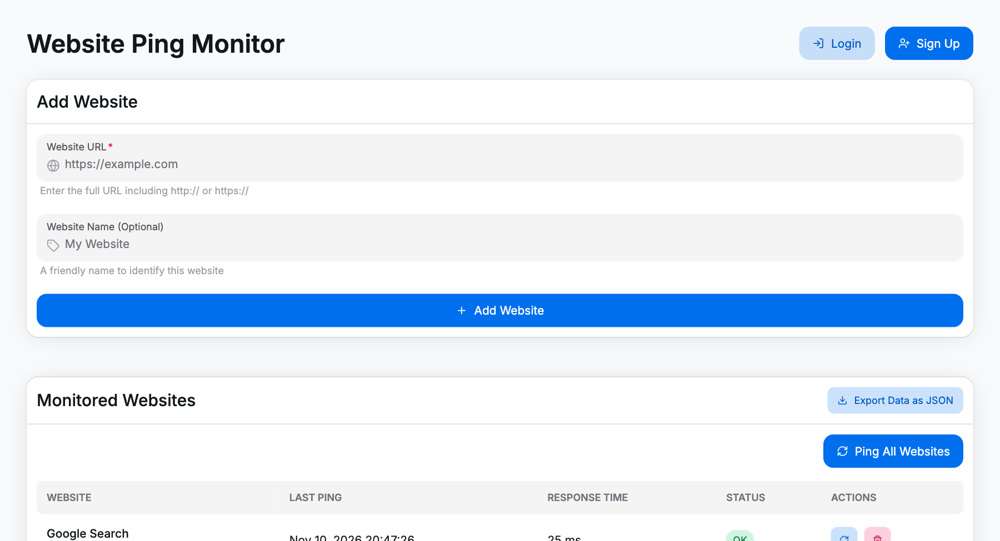
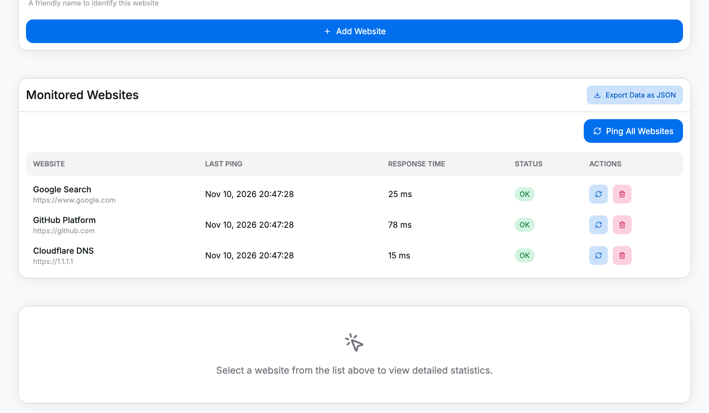
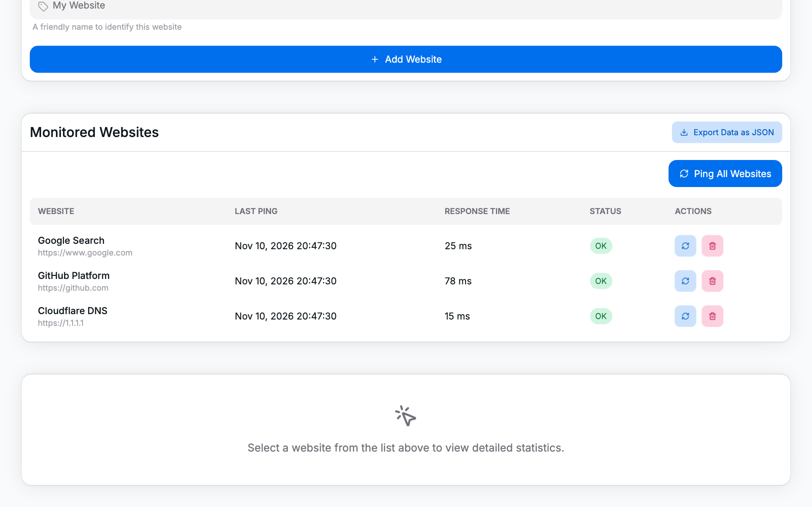

# Website Ping Monitor (TAD Kursova)

Інтерактивна веб-панель для моніторингу доступності (uptime), часу затримки (latency) та статусу веб-ресурсів у реальному часі. Проєкт розроблено в рамках курсової роботи з дисципліни «Технології аналізу даних» (ТАД).

[](https://react.dev/)
[](https://www.typescriptlang.org/)
[](https://vitejs.dev/)
[](https://tailwindcss.com/)
[](https://heroui.com/)

---

## Огляд інтерфейсу та прив'язка до компонентів

### 1. Керування моніторингом та список ресурсів
**Файли:** `TadKursova/src/components/add-website-form.tsx`, `website-list.tsx`, `hooks/use-ping-monitor.ts`

<p align="center">
  
</p>

- Форма швидкого додавання сайтів із валідацією назви та коректності URL.
- Картки активних ресурсів із кнопками індивідуального опитування та видалення.
- Панель швидких дій: кнопка масового пінгу всіх збережених серверів та вивантаження даних.

---

### 2. Візуалізація динаміки часу відгуку (Latency Timeline)
**Файли:** `TadKursova/src/components/ping-history-chart.tsx`

<p align="center">
  
</p>

- Інтерактивний часовий графік затримок на базі бібліотеки **Recharts**.
- Відображення коливань швидкості відповіді (мс) для обраного веб-ресурсу.
- Тултіпи з фіксацією точного часу заміру та числовим значенням затримки.

---

### 3. Зведена аналітика (KPI) та журнал перевірок
**Файли:** `TadKursova/src/components/ping-statistics.tsx`, `ping-response-time-table.tsx`

<p align="center">
  
</p>

- Аналітичні картки ключових показників: середній час відгуку, відсоток доступності (uptime), мінімальний та максимальний пінг.
- Детальна таблиця логів замірів із кодами відповідей (HTTP 200 OK), часовими мітками та статусами у вигляді чіпів HeroUI.
- Експорт повної історії замірів у файл формату **JSON** для подальшого аналізу.

---

## Стек технологій

| Сфера | Технології |
|---|---|
| **Core** | React 18, TypeScript, Vite 6 |
| **UI та стилізація** | HeroUI (`@heroui/react`), Tailwind CSS, Framer Motion, Iconify |
| **Графіка та дані** | Recharts (візуалізація часових рядів), date-fns (робота з датами) |

---

## Структура проєкту

```text
tad-kursova.github.io/
├── assets/                          # Скріншоти та матеріали документації
│   ├── website-management.png
│   ├── latency-chart.png
│   └── statistics-table.png
├── TadKursova/
│   ├── src/
│   │   ├── components/
│   │   │   ├── add-website-form.tsx         # Форма додавання URL до моніторингу
│   │   │   ├── ping-history-chart.tsx       # Графік часових рядів затримки (Recharts)
│   │   │   ├── ping-response-time-table.tsx # Таблиця детальної історії перевірок
│   │   │   ├── ping-statistics.tsx          # Зведені картки аналітики (KPI)
│   │   │   ├── website-details.tsx          # Детальний звіт за обраним ресурсом
│   │   │   └── website-list.tsx             # Список доданих сайтів та їхній статус
│   │   ├── hooks/
│   │   │   └── use-ping-monitor.ts          # Логіка пінгу та збереження в localStorage
│   │   ├── App.tsx                          # Головний контейнер інтерфейсу
│   │   └── main.tsx                         # Точка входу додатку
│   ├── tailwind.config.js
│   ├── vite.config.ts
│   └── package.json
└── README.md
```

---

## Швидкий запуск

### Вимоги
- [Node.js](https://nodejs.org/) версії 18+
- Менеджер пакетів `npm` (або `pnpm` / `yarn`)

### Встановлення та запуск

1. Склонувати репозиторій:
   ```bash
   git clone https://github.com/Magshproget/tad-kursova.github.io.git
   cd tad-kursova.github.io/TadKursova
   ```

2. Встановити залежності:
   ```bash
   npm install
   ```

3. Запустити локальний сервер розробки:
   ```bash
   npm run dev
   ```
   Додаток буде доступний за адресою: `http://localhost:5173`

4. Збірка для продакшну:
   ```bash
   npm run build
   ```
