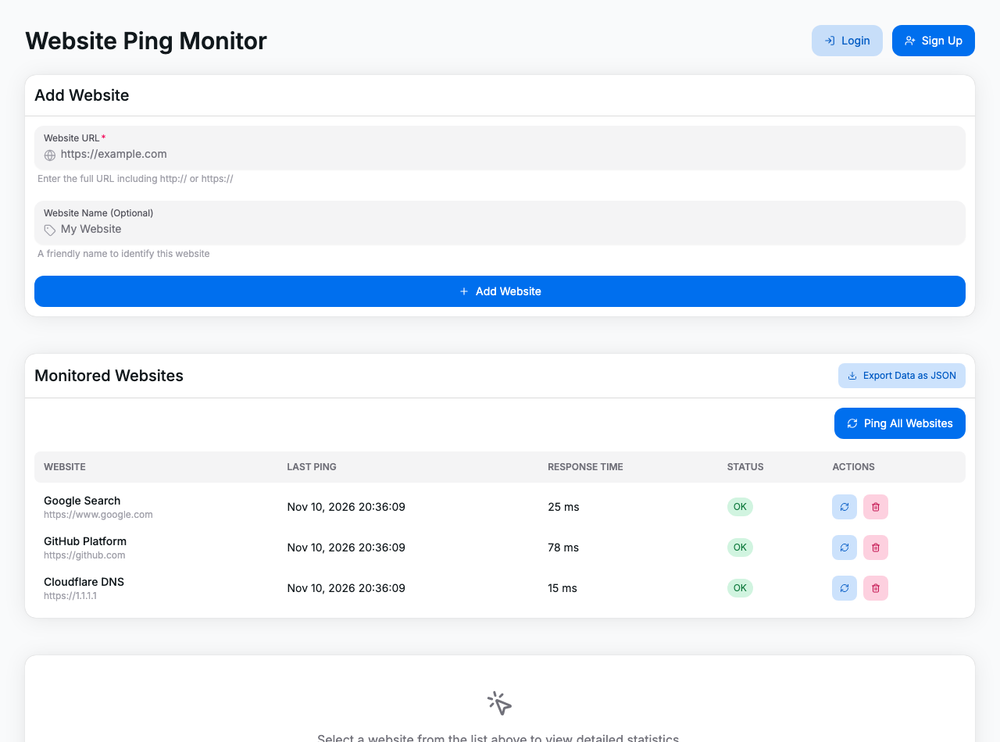

# Website Ping Monitor (TAD Kursova)

Інтерактивна веб-панель для моніторингу доступності (uptime), часу затримки (latency) та статусу веб-ресурсів у реальному часі. Проєкт розроблено в рамках курсової роботи з дисципліни «Технології аналізу даних» (ТАД).

[](https://react.dev/)
[](https://www.typescriptlang.org/)
[](https://vitejs.dev/)
[](https://tailwindcss.com/)
[](https://heroui.com/)

<p align="center">
  
</p>

---

## Основні можливості

- **Моніторинг у реальному часі**:
  - Індивідуальний та масовий пінг ресурсів («Опитати всі сайти»).
  - Замір точного часу відгуку (`latency` в мс) та фіксація статусів.
- **Візуалізація та аналітика**:
  - Інтерактивні часові графіки динаміки відгуку на базі **Recharts**.
  - Зведені картки метрик: середній час відповіді, відсоток доступності, максимальна та мінімальна затримка.
  - Таблиця історії перевірок із мітками часу, кодами відповідей та фільтрацією.
- **Збереження та експорт даних**:
  - Автоматичне збереження списку ресурсів та історії замірів у `localStorage` браузера.
  - Експорт накопиченої аналітики у файл **JSON** для подальшого аналізу.
- **Інтерфейс користувача**:
  - Компонентна база на **HeroUI** з анімаціями переходів на **Framer Motion**.
  - Адаптивний дизайн із підтримкою темної та світлої теми.

---

## Стек технологій

| Сфера | Технології |
|---|---|
| **Core** | React 18, TypeScript, Vite 6 |
| **UI та стилізація** | HeroUI (`@heroui/react`), Tailwind CSS, Framer Motion, Iconify |
| **Графіка та дані** | Recharts (візуалізація часових рядів), date-fns (робота з датами) |

---

## Структура проєкту

```text
tad-kursova.github.io/
├── TadKursova/
│   ├── src/
│   │   ├── components/
│   │   │   ├── add-website-form.tsx         # Форма додавання URL до списку моніторингу
│   │   │   ├── ping-history-chart.tsx       # Графік часових рядів затримки (Recharts)
│   │   │   ├── ping-response-time-table.tsx # Таблиця детальної історії перевірок
│   │   │   ├── ping-statistics.tsx          # Зведені картки аналітики (KPI)
│   │   │   ├── website-details.tsx          # Детальний звіт за обраним ресурсом
│   │   │   └── website-list.tsx             # Список доданих сайтів та їхній статус
│   │   ├── hooks/
│   │   │   └── use-ping-monitor.ts          # Стан додатку, робота з localStorage та логіка пінгу
│   │   ├── App.tsx                          # Головний контейнер панелі управління
│   │   └── main.tsx                         # Точка входу додатку
│   ├── tailwind.config.js
│   ├── vite.config.ts
│   └── package.json
└── README.md
```

---

## Швидкий запуск

### Вимоги
- [Node.js](https://nodejs.org/) версії 18+
- Менеджер пакетів `npm` (або `pnpm` / `yarn`)

### Встановлення та запуск

1. Склонуйте репозиторій:
   ```bash
   git clone https://github.com/Magshproget/tad-kursova.github.io.git
   cd tad-kursova.github.io/TadKursova
   ```

2. Встановіть залежності:
   ```bash
   npm install
   ```

3. Запустіть локальний сервер розробки:
   ```bash
   npm run dev
   ```
   Додаток буде доступний за адресою: `http://localhost:5173`

4. Збірка для продакшну:
   ```bash
   npm run build
   ```
